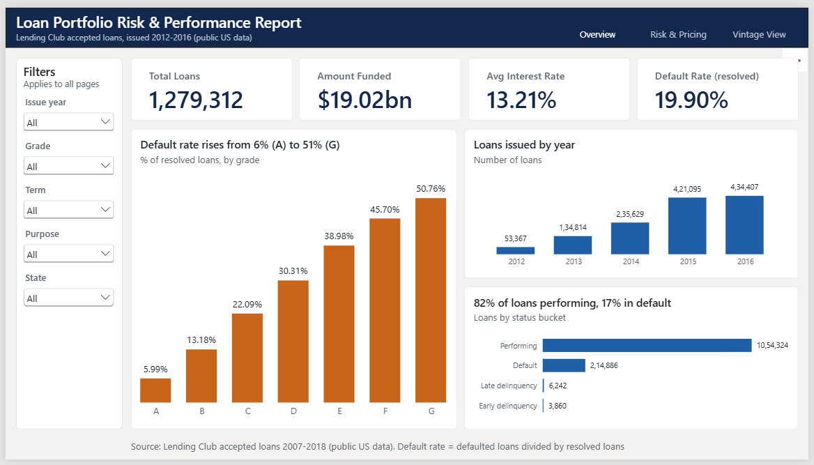
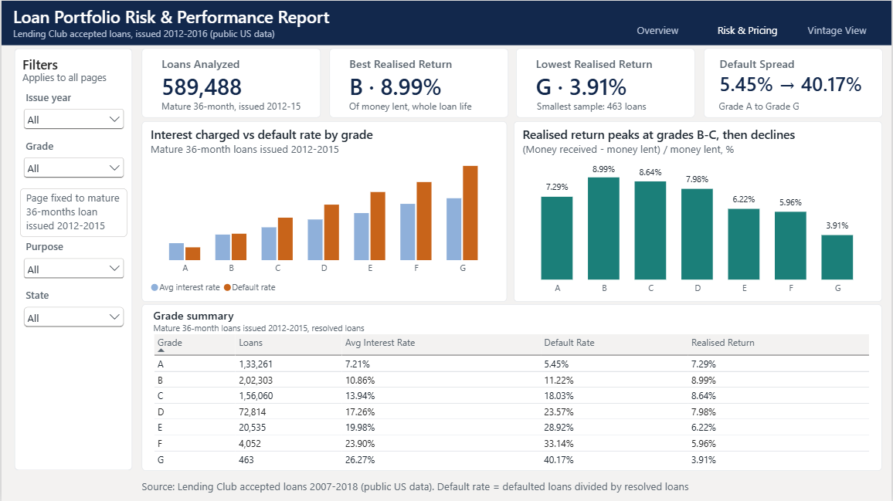
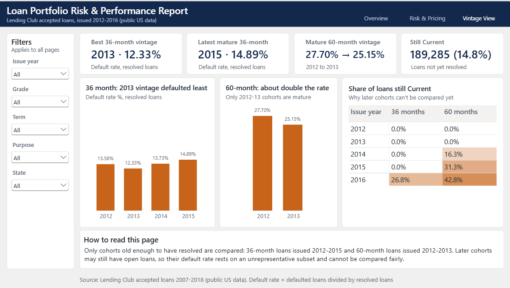

# Loan Portfolio Risk & Performance Report

An end-to-end reporting project on **1,279,312 loans**: Python for cleaning, MySQL for KPI queries and reconciliation, and a 3-page Power BI report for management. It answers four questions a lending business asks every month:

1. How large is the loan book, and how risky is it?
2. Is the interest charged high enough to pay for the losses?
3. Has loan quality changed from one issue year to the next, and why?
4. Where are the losses concentrated?

> **Data note:** This is public US peer-to-peer lending data (Lending Club), not an Indian bank's internal data. The project is for learning and portfolio purposes.

---

## Headline results

| Measure | Value |
|---|---|
| Loans analysed (issued 2012 to 2016) | 1,279,312 |
| Amount funded | $19.02 billion (about $14,900 per loan) |
| Average interest rate | 13.21% |
| Default rate, resolved loans, all cohorts | 19.90% (on 1,079,925 resolved loans) |
| Default rate by grade | 5.99% (A) rising to 50.76% (G) |
| Mature 36-month loans | 589,488 loans, 14.03% default, 8.24% realised return |
| Mature 60-month loans | 44,279 loans, 25.72% default, 19.30% realised return (whole-loan return, not comparable with 36-month) |
| Best and lowest realised return, mature 36-month | Grade B 8.99%, grade G 3.91% |
| Loans still open (Current) | 189,285 (14.8%) |

---

## Dashboard
Link for PowerBI dashboard: https://drive.google.com/file/d/1Xt9KldGBWzxMdMjVJJdr6-YUiVH7KJZv/view?usp=drive_link
| Page | What it shows |
|---|---|
| **1. Overview** | Four KPI cards, default rate by grade, loans issued by year, loans by status bucket |
| **2. Risk & pricing** | Interest rate vs default rate by grade, realised return by grade, grade summary table (mature 36-month loans only) |
| **3. Vintage view** | Default rate by issue year for 36-month and 60-month loans, and the share of loans still open by cohort |





---

## Key findings

Unless stated otherwise, "mature 36-month loans" means 36-month loans issued 2012 to 2015 that have finished (589,488 loans), and "mature 60-month loans" means 60-month loans issued 2012 to 2013 (44,279 loans). Figures marked "about" were calculated by hand from the SQL result tables.

### 1. Risk rises steeply with grade

The default rate on resolved loans goes from 5.99% for grade A to 50.76% for grade G. A grade G loan defaulted about 8.5 times as often as a grade A loan. The rate more than doubles from A to B (5.99% to 13.18%) and keeps rising at every step.

### 2. Higher interest does not buy a proportionally higher return

On mature 36-month loans, realised return peaks at **grade B (8.99%)** and **grade C (8.64%)**, then falls to **3.91% at grade G**. Grade G charges about 2.4 times the interest rate of grade B (26.27% against 10.86%) but earns less than half of B's return. Every grade stays positive, but these returns are before servicing and funding costs, which the data does not contain.

On mature 60-month loans, realised return rises from 13.41% (grade A) to between 19.3% and 20.9% for grades C to G, then flattens. These are whole-loan returns over up to five years, not annual rates, so they must not be compared with the 36-month figures. Compare grades within a term only.

### 3. Where the money is lost, in dollars

Mature 36-month loans lent **$7.45 billion**. They earned about $1.12 billion in interest and $76 million in recoveries, and lost about **$588 million of principal** before recoveries. Recoveries won back about 13% of the lost principal, and that share was similar across grades.

| Grade | Lent ($M) | Interest received ($M) | Principal lost ($M) | Principal lost per $1 of interest |
|---|---|---|---|---|
| A | 1,901.8 | 182.3 | 50.2 | $0.28 |
| B | 2,528.9 | 358.5 | 150.6 | $0.42 |
| C | 1,865.9 | 330.4 | 194.7 | $0.59 |
| D | 862.4 | 182.9 | 131.4 | $0.72 |
| E | 245.6 | 57.8 | 49.2 | $0.85 |
| F | 39.5 | 10.9 | 10.0 | $0.92 |
| G | 5.9 | 1.7 | 1.7 | $1.00 |

- Grade G lost as much principal as it earned in interest, before recoveries.
- Grades D to G were about 15.5% of the dollars lent but about 33% of the principal lost.
- Grade C alone was 25% of the dollars lent and 33% of the principal lost.
- Net of interest and recoveries, grade B made the most money, about $227 million (roughly 37% of the group's total of about $613 million). Grades E to G together made about $18 million (3%).

### 4. Loan quality got worse after 2013, and it was not a change in borrower mix

The default rate for mature 36-month cohorts was 13.58% (2012), 12.33% (2013), 13.73% (2014) and 14.89% (2015). The 2015 cohort defaulted about 21% more often than the 2013 cohort.

Splitting by grade shows that default rates rose **within every grade**, and the rise grew with risk:

| Grade | 2013 default rate | 2015 default rate | Change (points) |
|---|---|---|---|
| A | 4.56% | 5.42% | +0.86 |
| B | 9.79% | 11.90% | +2.11 |
| C | 15.30% | 19.44% | +4.14 |
| D | 20.39% | 26.22% | +5.83 |
| E | 23.31% | 32.84% | +9.53 |
| F | 26.81% | 42.40% | +15.59 |

Grade G is left out of the table because 2013 had only 15 grade G loans.

The grade mix did not cause the rise. Grades A and B were about 57% of loans in both years. If 2015 loans had defaulted at 2013's grade-level rates, the 2015 default rate would have been about 11.8%, against the actual 14.89%. What drove the deterioration (underwriting, loan purpose, borrower income, the economy) was not analysed in this project.

### 5. Returns fell sharply as volume grew

| Issue year | Loans | Average interest rate | Default rate | Realised return |
|---|---|---|---|---|
| 2012 | 43,470 | 12.63% | 13.58% | 10.19% |
| 2013 | 100,422 | 13.37% | 12.33% | 11.05% |
| 2014 | 162,570 | 12.47% | 13.73% | 9.00% |
| 2015 | 283,026 | 11.28% | 14.89% | 6.55% |

Between 2013 and 2015 the average interest rate fell by about 2.1 points while the default rate rose by 2.6 points, so both moved the wrong way. The 2015 cohort had 2.8 times the loans of 2013 but earned about 59% of the return per dollar lent (6.55% against 11.05%).

### 6. 60-month loans default more, mostly because of who takes them

Mature 60-month cohorts defaulted at 27.70% (2012) and 25.15% (2013), about twice the 36-month rate of the same issue years. Much of that gap is grade mix: grades C to E make up about 72% of mature 60-month loans but about 42% of mature 36-month loans, and grades A and B make up about 14% against about 57%. Within the same grade, 60-month loans defaulted roughly 3 to 4 points more for grades A to F and about 2 points less for grade G. The two groups cover different issue years, so this is a comparison, not a controlled test.

### 7. Loan purpose (mature 36-month loans)

| Purpose | Loans | Default rate | Realised return |
|---|---|---|---|
| Debt consolidation | 337,680 | 14.70% | 8.16% |
| Credit card | 145,994 | 11.71% | 8.55% |
| Home improvement | 33,568 | 12.53% | 8.04% |
| Other | 30,570 | 16.40% | 9.18% |
| Major purchase | 11,200 | 13.09% | 6.86% |
| Medical | 6,382 | 17.25% | 7.52% |
| Small business | 6,165 | 22.51% | 6.22% |
| Car | 5,914 | 11.94% | 7.59% |
| Moving | 4,139 | 19.50% | 6.68% |
| Vacation | 3,991 | 15.89% | 7.48% |
| House | 2,316 | 18.26% | 7.43% |
| Wedding | 1,174 | 12.69% | 11.30% |

Purposes with fewer than 1,000 loans (renewable energy 394, educational 1) are left out.

- Debt consolidation and credit card refinancing make up about 82% of loans.
- **Small business is the riskiest sizeable purpose**: a 22.51% default rate, about 1.6 times the 14.03% average, and a return of 6.22%, two points below average. It is only about 1% of loans.
- Purposes with the highest default rates do not always have the lowest returns. "Other" defaulted at 16.40% but returned 9.18%, so it was priced to cover the risk.

### 8. State (mature 36-month loans, states with at least 5,000 loans)

Of the 31 qualifying states, default rates ran from 11.01% (Kansas) to 17.32% (Nevada), a spread of about 6.3 points around the 14.03% average.

- **Highest:** Nevada 17.32%, Oklahoma 16.98%, Alabama 16.63%, Tennessee 16.05%, Louisiana 15.76%.
- **Lowest:** Kansas 11.01%, Oregon 11.10%, South Carolina 11.36%, Colorado 11.40%, Washington 11.40%.
- Among the largest states, Florida (15.55%) and New York (15.40%) are above average, California (14.26%) is close to it, and Texas (13.55%), Georgia (12.21%) and Illinois (12.17%) are below it.

State rates are not adjusted for grade mix, so they show where defaults were higher, not why.

### 9. The portfolio is young, and growth has flattened

Loans issued grew from 53,367 in 2012 to 434,407 in 2016, about 8 times, but the last step was small: 421,095 in 2015 to 434,407 in 2016, up 3.2%. About two-thirds (66.9%) of all loans were issued in 2015 and 2016, so most of the book has not finished repaying.

### 10. Few loans are in delinquency

82.4% of loans are performing and 16.8% are in the Default bucket (Charged Off plus 12 loans in Default). Only about 0.8% sit in early or late delinquency (3,860 and 6,242 loans).

### 11. The headline 19.90% is not a lifetime default rate

The 19.90% mixes finished cohorts with young ones. Splitting the 1,079,925 resolved loans:

| Group | Resolved loans | Default rate |
|---|---|---|
| Mature cohorts (36-month 2012 to 2015, 60-month 2012 to 2013) | 633,767 | about 14.8% |
| Cohorts not yet mature (36-month 2016, 60-month 2014 to 2016) | 446,158 | about 27.1% |
| All resolved loans | 1,079,925 | 19.90% |

Young cohorts have a much higher default rate among loans that have resolved. Two things could cause this and the data cannot separate them: later cohorts may genuinely be riskier (finding 4 shows this happened within the mature 36-month cohorts), and resolved loans in a young cohort are an early, unrepresentative subset of that cohort. For the same reason, default rates for 2016 (19.85% on 36-month and 36.43% on 60-month loans) should not be compared with mature cohorts. The pricing and vintage pages use mature cohorts only.

---

## What a lender could do with this

1. **Review pricing and limits for grades D to G.** They were about 15.5% of dollars lent and about 33% of principal lost. Grade E lost 85 cents of principal for every $1 of interest, and grade G lost all of it. Returns on grades E to G (6.22%, 5.96%, 3.91%) were well below grade B's 8.99%, before servicing and funding costs.
2. **Investigate the 2014 and 2015 cohorts.** Default rates rose within every grade, most in the riskier ones, while average interest fell. Return fell from 11.05% to 6.55%. The first questions are whether underwriting loosened and whether pricing followed the risk.
3. **Look at small-business loans.** A 22.51% default rate and a 6.22% return are the weakest of any sizeable purpose.
4. **Check the states with the highest default rates** (Nevada, Oklahoma, Alabama, Tennessee, Louisiana) after adjusting for grade mix.
5. **Report default by loan age, not just by status.** With 14.8% of loans still open, resolved-only default rates mislead for young cohorts.
6. **Track annualised return**, so that 36-month and 60-month loans can be compared fairly.
7. **Watch the young book.** Two-thirds of loans are from the last two issue years and have not finished repaying.

---

## Data

- **Source:** Lending Club accepted loans, 2007 to 2018, from Kaggle (the "accepted" file, 2,260,701 rows and 151 columns). The "rejected" file was not used because it has no loan outcomes.
- **Scope:** loans issued 2012 to 2016, which leaves **1,279,312 loans** and 25 columns. Earlier years behave differently, and loans issued after 2016 had not had time to resolve.
- **Not included in this repository:** the raw file is too large and comes from Kaggle. Download it from Kaggle and place it in the project folder.

---

## Method

### 1. Cleaning (Python, pandas)

The file is read in chunks of 200,000 rows, filtered to 2012 to 2016 and 25 columns, and cleaned. Every step is logged.

| Check | Rows affected |
|---|---|
| Duplicate loan IDs | 0 |
| Invalid issue dates | 0 |
| Non-positive loan amount or implausible interest rate | 0 |
| DTI outside 0 to 100, set to missing (loan kept) | 136 |
| Missing employment length, set to "Unknown" | 71,937 |

Derived fields: term in months, issue year and quarter, status bucket, default flag, resolved flag, average FICO score. A rough `principal_shortfall` field was also created but is not used in the report.

### 2. Status buckets

| Bucket | Loan statuses | Loans |
|---|---|---|
| Performing | Fully Paid (865,039), Current (189,285) | 1,054,324 |
| Early delinquency | In Grace Period, Late (16 to 30 days) | 3,860 |
| Late delinquency | Late (31 to 120 days) | 6,242 |
| Default | Charged Off, Default | 214,886 |

This is similar in spirit to the stages banks use (such as SMA and NPA) but not identical.

### 3. Definitions

| Term | Definition |
|---|---|
| Resolved loan | Status Fully Paid, Charged Off or Default |
| Default | Status Charged Off or Default |
| Default rate | Defaulted loans divided by resolved loans |
| Realised return | (Money received minus money lent) divided by money lent, on resolved loans. Money received is `total_pymnt`, which includes recoveries (checked: two ways of calculating it agree within 0.03 points). Gross of servicing and funding costs. Not annualised. |
| Principal lost | Amount funded minus principal repaid, on defaulted loans, before recoveries |
| Mature cohort | 36-month loans issued 2012 to 2015, and 60-month loans issued 2012 to 2013. These cohorts have almost no open loans. |
| Current share | Loans with status Current divided by all loans in the group |

### 4. Why resolved loans and mature cohorts

14.8% of loans (189,285) are still Current. A default rate over all loans would count open loans as non-defaults, and a default rate over resolved loans only is unreliable for young cohorts. The share still open is about 0% for 36-month loans issued up to 2015, but 26.8% for 36-month loans issued in 2016, and 16.3%, 31.3% and 42.8% for 60-month loans issued in 2014, 2015 and 2016. The pricing and vintage pages therefore use mature cohorts only.

### 5. A result that did not hold up

My first pricing table used all resolved loans and showed negative returns for grades F and G (-1.85% and -4.41%). On mature 36-month loans only, every grade was positive. The negative figures came from young 60-month loans, where resolved-only data is unreliable. This is reported here because it shows why cohort age matters.

---

## Reconciliation

The same totals were calculated in Python, MySQL and Power BI, and the numbers matched at every check.

| Check | Python | MySQL | Power BI |
|---|---|---|---|
| Total loans | 1,279,312 | 1,279,312 | 1,279,312 |
| Default rate, resolved loans | 19.90% | 19.90% | 19.90% |
| Status buckets | 1,054,324 / 214,886 / 6,242 / 3,860 | Match | Match |
| Default rate by grade | 5.99% to 50.76% | Match | Match |
| 36-month default rate by vintage, 2012 to 2015 | 13.58% / 12.33% / 13.73% / 14.89% | Match | Match |
| Realised return by grade, mature 36-month | n/a | Match | Match |

Further internal consistency checks on the SQL results:

- Resolved loans summed across issue years and terms = **1,079,925**, which equals 1,279,312 total loans minus 189,285 Current, 3,860 early delinquent and 6,242 late delinquent loans.
- Loans by purpose sum to 589,488, the same as the mature 36-month total. Loans by grade within each issue year sum to the yearly totals.
- Interest, recoveries and principal lost by grade rebuild the realised return by grade to within rounding (for example grade B: $358.5M + $19.2M - $150.6M on $2,528.9M lent is 8.98%, against 8.99% reported).

---

## Power BI build notes

- The report is 1280 x 720, three pages, using the full 1.28 million-row table.
- Measures are written in DAX and kept in a `_Measures` table.
- **Page 2** is fixed to mature 36-month loans issued 2012 to 2015 using page-level filters. It has no Term slicer for that reason.
- **Page 3** charts use visual-level filters: 36-month loans up to 2015, and 60-month loans up to 2013. The matrix shows every cohort, and its measures return zero, not blank, so that cohorts with no open loans still appear.
- The filter panel uses native dropdown slicers. Chip-style slicers need a custom visual that was not available.
- Several KPI cards use text measures so that full counts (1,279,312) show instead of abbreviations (1M).
- Cumulative returns are not annualised, so the report never compares returns across terms.

---

## Limitations

- **US data, public dataset.** It is not an Indian bank's book, and has no internal costs.
- **A benign period.** 2012 to 2015 was a favourable stretch for US consumer credit. Returns may be worse in a downturn.
- **Gross returns.** No servicing costs, collection fees or cost of funds. Returns are not annualised, so 36-month and 60-month figures cannot be compared.
- **Young cohorts.** Cohorts that have not finished repaying cannot be compared fairly with mature ones, and the data cannot say how much of their higher default rate is real.
- **Thin samples at the top grades.** Grade F has 4,052 and grade G has 463 mature 36-month loans, and mature 60-month grade A has only 770. Grade G in 2013 has 15 loans.
- **Two mature 60-month cohorts only.** Their trend should not be over-read.
- **No cause analysis.** The report shows that the 2014 and 2015 cohorts did worse, and that it was not a grade-mix effect, but not why.
- **State and purpose comparisons are not adjusted for grade.**
- **Status snapshot.** Loan statuses are as of the dataset's last update.

---

## Possible next steps

- Annualised return, using the actual time each loan was held.
- Default rate by months on book, so cohorts of different ages compare fairly.
- Why the 2014 and 2015 cohorts weakened: loan purpose, income, debt-to-income and FICO by cohort.
- Grade-adjusted state and purpose comparisons.
- A predictive model of default, building on the cleaned data.

---

## Repository structure


```
loan-risk-report/
├── README.md
├── risk_analysis.ipynb
├── sql/
│   └── kpi_queries.sql
├── images/
│   ├── page1-overview.png
│   ├── page2-risk-pricing.png
│   └── page3-vintage-view.png
└── docs/
    └── data_quality_log.csv
```

## Tools

Python, MySQL, Power BI, GitHub.

## Author

Om Sonawane, [LinkedIn](https://linkedin.com/in/om--sonawane)
